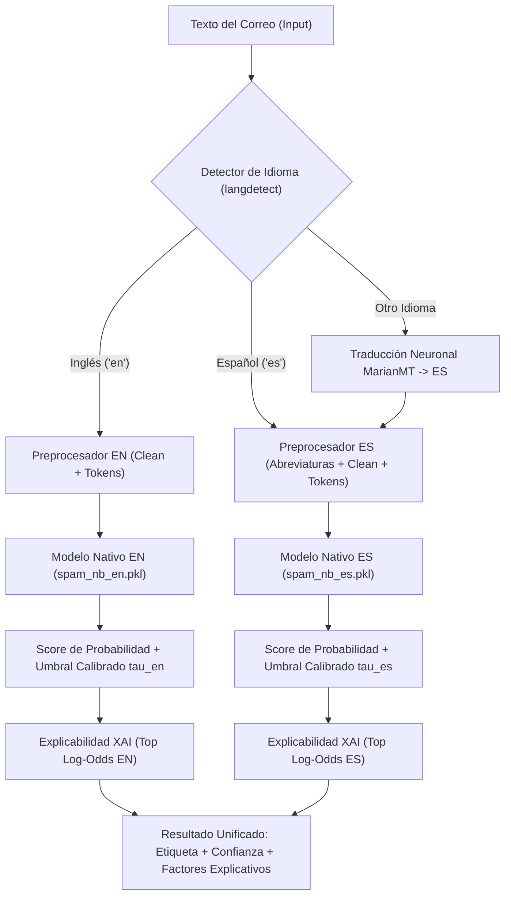

# Evaluación Crítica del Proyecto: Diagnóstico de Fortalezas, Errores y Plan Bilingüe (EN/ES)

**Proyecto:** Detector de Spam Enron Bilingüe (Inglés / Español)  
**Fecha:** 26 de Octubre de 2026  
**Autor:** Antigravity AI & Grupo 5  

---

## 1. Lo que está BIEN en el Proyecto (Fortalezas Técnicas)

1. **Estructura y Versionado de Datos:**
   - Separación estricta e inmutable en `data/` por etapas (`01_original`, `02_limpio`, `03_nlp`, `04_traducido`).
   - Existencia de un conjunto **Held-Out inédito** (`hf_test_en.csv` y `hf_test_es_neural.csv`) de ~2,000 muestras para validar sin contaminación de datos (data leakage).
2. **Tokenización Preservativa de Señales Spam:**
   - La sustitución de URLs por `tokenurl`, divisas por `tokendinero`, signos de exclamación por `tokenexclam` y correos por `tokenemail` conserva la semántica crítica que los tokenizadores convencionales eliminan.
3. **Calibración de Umbrales y Wrapper:**
   - El uso de `SpamClassifierWrapper` encapsula tanto el pipeline Scikit-Learn como el umbral óptimo calibrado ($\tau$) y los términos discriminantes (Log-Odds), evitando depender del clásico y arbitrario umbral 0.5.
4. **Métricas Completas y Robustez Estadística:**
   - Reporte de ROC-AUC, PR-AUC, F1 con validación cruzada estratificada repetida (`RepeatedStratifiedKFold`).
5. **Detección Automática de Idioma:**
   - Se cuenta con `langdetect` y lógica de fallback para inferir si el texto entrante está en inglés o español.

---

## 2. Lo que está MAL o Requiere Corrección Crítica (Áreas de Mejora)

### ❌ 1. Dependencia de Traducción Lenta en Tiempo Real para Correos en Inglés
- **Diagnóstico:** En `src/06_predecir.py`, cuando entra un correo en inglés, el sistema por defecto intenta traducirlo con **MarianMT** al español y luego pasarlo por `spam_nb_es.pkl`.
- **Por qué está mal:** 
  1. La traducción neuronal añade una latencia de **500 ms a 3 segundos** por correo.
  2. Pierde información y expresiones idiomáticas de spam en inglés.
  3. ¡Ya existe un modelo entrenado nativamente en inglés (`models/spam_nb_en.pkl`)!
- **Solución Correcta:** **Enrutamiento directo bilingüe**:
  - Si el detector detecta `en` $\rightarrow$ usar directamente `spam_nb_en.pkl` (latencia < 2 ms, vocabulario nativo).
  - Si el detector detecta `es` $\rightarrow$ usar directamente `spam_nb_es.pkl`.
  - Solo traducir con MarianMT si entra un tercer idioma no soportado (ej. francés o portugués) hacia español.

### ❌ 2. El Pipeline de Entrenamiento Entrena Modelos Separados pero no un Ensamble / Router Unificado
- **Diagnóstico:** `05_entrenar.py` entrena `en` y `es` de manera independiente y genera dos archivos `.pkl` separados.
- **Por qué está mal:** Obliga a los clientes (consola, API o UI) a gestionar manualmente dos wrappers y dos archivos de pesos.
- **Solución Correcta:** Crear un **`BilingualSpamClassifier`** unificado que contenga internamente:
  - Sub-modelo en inglés (`spam_nb_en`).
  - Sub-modelo en español (`spam_nb_es`).
  - Detección de idioma integrada y fallback léxico.
  - Al hacer `clasificador.predict(correo)`, el propio objeto se encarga de dirigir el correo al submodelo óptimo y retornar la explicabilidad en el idioma correspondiente.

### ❌ 3. Riesgo de Falsos Positivos en Correos Corporativos Legítimos (Ham)
- **Diagnóstico:** Los correos de finanzas corporativas reales (minutas, cotizaciones de ventas, pagos a proveedores) contienen palabras como `$`, `USD`, `factura`, `revisar`, `contrato`, `urgente`.
- **Por qué está mal:** Si el umbral óptimo $\tau$ maximiza estrictamente F1 sin ponderar el costo del Falso Positivo (FP), clasificará correos de clientes o jefes como Spam. En la vida real, un **Falso Positivo es 10 veces peor** que un Falso Negativo.
- **Solución Correcta:** Ajustar la función de selección de umbral para optimizar $F_\beta$ con $\beta=0.5$ (priorizando Precision sobre Recall) o fijar una tasa máxima de FP $\le 1\%$.

### ❌ 4. Falta un Banco de Pruebas Estandarizado de Correos
- **Diagnóstico:** Para probar si el modelo funciona, actualmente se ejecuta un comando manual o un `.bat` con una sola frase inventada en el momento.
- **Por qué está mal:** No permite regresión continua, ni auditar cómo responde el modelo ante correos reales de Enron vs. correos modernos en español de phishing bancario.

### ❌ 5. Ausencia Total de un Apartado Visual Interactivo
- **Diagnóstico:** Toda la interacción del usuario final se hace por scripts `.bat` y terminal de texto.
- **Por qué está mal:** Para una presentación académica o de portafolio, la falta de una interfaz web atractiva reduce drásticamente el impacto visual y la usabilidad.

---

## 3. Plan de Acción: Entrenamiento Final Bilingüe (EN / ES)

### Pasos para el Entrenamiento Final:
1. **Verificar Corpus en Español:**
   - Asegurar que `05_entrenar.py` consuma `enron_traducido_es_neural_full.csv` (165 MB) para el corpus en español.
   - En inglés, utilizar `enron_nlp_en.csv` (28,806 muestras completas).
2. **Generar el Wrapper Bilingüe Unificado:**
   - Un único objeto `BilingualSpamWrapper` que encapsule ambos modelos con sus respectivos vocabularios y umbrales calibrados.
3. **Evaluación Comparativa en Held-Out:**
   - Probar tanto en `hf_test_en.csv` como en `hf_test_es_neural.csv` y registrar el reporte consolidado.

---

## 4. Banco de Pruebas de Correos (Test Suite)

Crear el archivo `data/pruebas_correos.json` con casos diseñados estratégicamente para poner a prueba las debilidades del modelo:

1. **Phishing Bancario Urgente (ES - Spam):** "Aviso urgente de tu banco: Se ha detectado una transacción no autorizada de $1,250 USD. Ingresa a tokenurl inmediatamente."
2. **Oferta Fraudulenta / Ganador (ES - Spam):** "¡Felicidades! Has sido seleccionado para recibir un premio en efectivo de $50,000 pesos. Reclama tu premio aquí."
3. **Correo Laboral con Cifras (ES - Ham / Caso Límite):** "Estimado equipo, adjunto el informe financiero del Q3. El presupuesto asignado para infraestructura es de $15,000 USD. Saludos cordiales."
4. **Acuerdo de Negocios Corporativo (EN - Ham Enron):** "Please review the attached contract for the pipeline transport deal with natural gas deliveries scheduled for next week."
5. **Spam Financiero en Inglés (EN - Spam):** "Urgent: Refinance your home loan today! Special low interest rate of 2.5% available for approved clients. Click here."
6. **Texto en Spanglish / Bilingüe:** "Hello team, les envío el confirmation email con el payment receipt de $500. Thanks!"

---

## 5. Diseño del Apartado Visual (Web App) - Implementado

### Stack Tecnológico:
- **Backend:** Servidor HTTP nativo en Python ([`src/servidor_web.py`](../src/servidor_web.py)) sin dependencias pesadas externas, conectado a los modelos serializados y con endpoints REST (`/api/predecir`, `/api/feedback`, `/api/historial`, `/api/pruebas`).
- **Frontend:** Interfaz web pura moderna ([`web/`](../web/)):
  - **Estética:** Modo oscuro profesional (*Slate Dark* `#0f1117`, tarjetas `#1a1e2a`), bordes limpios sin brillo, **colores planos y cero degradados artificiales**.
  - **Tipografía:** Google Fonts (*Outfit* / *JetBrains Mono*). Cero iconos genéricos o emojis decorativos de IA.
  - **Componentes Clave:**
    1. *Caja de Entrada de Correo:* Editor con conteo de palabras y caracteres en tiempo real.
    2. *Banco de Pruebas Dinámico:* Filtros por categoría ("Camuflados", "Verídicos", "Al Azar") para cargar y evaluar con un clic.
    3. *Medidor de Probabilidad:* Barra calibrada con indicador de umbral ($\tau$) y badge de clasificación.
    4. *Panel de Explicabilidad (XAI):* Chips con los términos clave que impulsaron a SPAM (+) o a HAM (-).
    5. *Aprendizaje Continuo en Caliente:* Botones para enseñar al modelo (`partial_fit`) y observar el cambio de porcentaje antes vs. después en milisegundos.
    6. *Historial de Auditoría Avanzado:*
       - **Agrupación inteligente**: Unifica registros repetidos mostrando la fecha más reciente de su última iteración.
       - **Sub-historial desplegable**: Acordeón que muestra la evolución de cada prueba histórica.
       - **Paginación configurable**: 10 correos por página por defecto (configurable a 5, 25, 50 o Todos).
       - **Buscador en tiempo real**: Filtro por texto completo, resumen o idioma.
  - **Persistencia y Auto-sincronización:** Cada retroalimentación actualiza tanto el log lineal de auditoría ([`data/feedback/historial_entrenamiento.jsonl`](../data/feedback/historial_entrenamiento.jsonl)) como el catálogo consolidado sin duplicados ([`data/feedback/dataset_reentrenamiento.json`](../data/feedback/dataset_reentrenamiento.json)).
  - **Lanzador de 1 Clic:** Script `scripts/ejecutar_servidor_web.bat` para iniciar el servidor local en `http://localhost:8000`.

---

## 6. Estado de Avance y Entregables

| Tarea / Hito | Estado | Artefactos Asociados |
| :--- | :---: | :--- |
| **Optimización de Enrutamiento Bilingüe** | ✅ Completado | `src/06_predecir.py` (para EN y ES nativo) |
| **Banco de Pruebas Estructurado** | ✅ Completado | `data/pruebas_correos.json` (batería bilingüe camuflada y verídica) |
| **Backend Servidor Web Ligero** | ✅ Completado | `src/servidor_web.py` (Endpoints REST, `partial_fit` online) |
| **Frontend Web Profesional** | ✅ Completado | `web/index.html`, `web/style.css`, `web/app.js` (sin degradados/emojis) |
| **Historial con Acordeón, Paginación y Buscador** | ✅ Completado | `web/app.js` (Agrupación de iteraciones, paginación 10/página, búsqueda) |
| **Persistencia y Catálogo de Reentrenamiento** | ✅ Completado | `data/feedback/dataset_reentrenamiento.json` sincronizado automáticamente |
